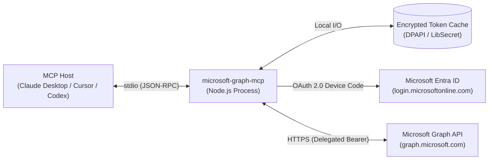

# Microsoft Graph MCP Server

[](LICENSE)
[](SECURITY.md)
[](https://www.typescriptlang.org/)
[](https://modelcontextprotocol.io)

A [Model Context Protocol](https://modelcontextprotocol.io) (MCP) server exposing **20 tools** that allow AI coding assistants and agent hosts to interact securely with Microsoft 365 services via the Microsoft Graph API — including **Outlook Mail, Calendar, OneDrive, Teams, and SharePoint**.

Designed for single-user desktop and developer environments using the MSAL **device-code (delegated) flow** with **persistent, encrypted token caching** (Windows DPAPI, macOS Keychain, Linux LibSecret).

---

## Architecture



- **Transport**: Standard input/output (`stdio`) JSON-RPC. No network ports or sockets are opened locally.
- **Identity**: Delegated user context only. No application credentials, client secrets, or directory-wide tenant admin rights.
- **Cache**: Persistent encrypted cache under `~/.microsoft-graph-mcp/` ensures silent re-authentication across restarts after initial consent.

---

## Supported MCP Hosts

Tested and compatible with stdio-based MCP clients:
- **Claude Desktop** (macOS, Windows)
- **Cursor IDE**
- **OpenAI Codex / ChatGPT Desktop**
- **OpenClaw CLI & Agent Frameworks**
- **MCP Inspector** (`@modelcontextprotocol/inspector`)

---

## Tool-by-Tool Permission & Scope Matrix

The server defines 20 tools. Each tool relies on Microsoft Graph REST endpoints that require specific delegated scopes:

| Category | Tool Name | Type | Microsoft Graph Endpoint | Delegated Scope | Admin Consent? |
| :--- | :--- | :--- | :--- | :--- | :--- |
| **Outlook** | `outlook_list_messages` | Read | `GET /me/mailFolders/inbox/messages` | `Mail.ReadWrite` | No |
| **Outlook** | `outlook_get_message` | Read | `GET /me/messages/{id}` | `Mail.ReadWrite` | No |
| **Outlook** | `outlook_send_mail` | Write | `POST /me/sendMail` | `Mail.Send` | No |
| **Outlook** | `outlook_create_draft` | Write | `POST /me/messages` | `Mail.ReadWrite` | No |
| **Outlook** | `outlook_search_messages` | Read | `GET /me/messages?$search={q}` | `Mail.ReadWrite` | No |
| **Calendar** | `calendar_list_events` | Read | `GET /me/calendarView` | `Calendars.ReadWrite` | No |
| **Calendar** | `calendar_get_event` | Read | `GET /me/events/{id}` | `Calendars.ReadWrite` | No |
| **Calendar** | `calendar_create_event` | Write | `POST /me/events` | `Calendars.ReadWrite` | No |
| **Calendar** | `calendar_update_event` | Write | `PATCH /me/events/{id}` | `Calendars.ReadWrite` | No |
| **Calendar** | `calendar_delete_event` | Write | `DELETE /me/events/{id}` | `Calendars.ReadWrite` | No |
| **OneDrive** | `onedrive_list_root` | Read | `GET /me/drive/root/children` | `Files.ReadWrite` | No |
| **OneDrive** | `onedrive_list_folder` | Read | `GET /me/drive/items/{id}/children` | `Files.ReadWrite` | No |
| **OneDrive** | `onedrive_search_files` | Read | `GET /me/drive/root/search(q='{q}')` | `Files.ReadWrite` | No |
| **OneDrive** | `onedrive_download_file` | Read | `GET /me/drive/items/{id}` | `Files.ReadWrite` | No |
| **OneDrive** | `onedrive_upload_file` | Write | `PUT /me/drive/items/{id}:/{name}:/content` | `Files.ReadWrite` | No |
| **OneDrive** | `onedrive_create_folder` | Write | `POST /me/drive/items/{id}/children` | `Files.ReadWrite` | No |
| **SharePoint** | `sharepoint_list_sites` | Read | `GET /sites?$search={q}` | `Sites.Read.All` | **Yes** |
| **SharePoint** | `sharepoint_get_site_details` | Read | `GET /sites/{id}/lists` | `Sites.Read.All` | **Yes** |
| **Teams** | `teams_list_chats` | Read | `GET /me/chats` | `Chat.ReadWrite` | **Yes** |
| **Teams** | `teams_send_chat_message` | Write | `POST /me/chats/{id}/messages` | `Chat.ReadWrite` | **Yes** |

---

## Threat Model & Security Posture

### 1. Scope Rationale & Minimisation
Delegated scopes such as `Mail.ReadWrite`, `Files.ReadWrite`, and `Chat.ReadWrite` are necessary to support draft creation, event updates, file management, and message posting. 

> [!TIP]
> **Restricting Permissions**: If your deployment only requires read access (e.g., retrieving emails and viewing calendars), you can restrict your Entra ID app registration to `Mail.Read`, `Calendars.Read`, and `Files.Read`. Tools requiring write operations will return clear authorization errors from Microsoft Graph without impacting read tools.

### 2. Local Credential Boundary
- **No Client Secrets**: Authentication relies purely on the public client device-code flow (`Allow public client flows = Yes`). There are no client secrets or certificate private keys stored on disk or passed to the server.
- **At-Rest Token Protection**: The MSAL token cache is encrypted using OS-native security primitives:
  - **Windows**: DPAPI (`DataProtectionScope.CurrentUser`), binding decryption to your Windows login session.
  - **macOS**: Apple Keychain Services.
  - **Linux**: Secret Service API (`libsecret`). In headless Linux or container environments where no keyring daemon exists, plaintext storage can be explicitly enabled with `MSAL_USE_PLAINTEXT_CACHE=true` (which emits an audit warning).

### 3. Agent Execution & LLM Guardrails
- **Human-in-the-Loop**: Actions that send emails (`outlook_send_mail`), post chat messages (`teams_send_chat_message`), or delete events (`calendar_delete_event`) execute with the full identity of the logged-in user. MCP host applications should be configured with user confirmation prompts before executing write/send tools.
- **Prompt Injection Defense**: When agents read emails or document contents, treat external text as untrusted data to prevent indirect prompt injection from influencing subsequent write actions.

---

## Setup Guide

### 1. Entra ID App Registration

1. Navigate to [Azure Portal](https://portal.azure.com/) → **Microsoft Entra ID** → **App registrations** → **New registration**.
2. **Name**: `Microsoft Graph MCP Server`.
3. **Supported account types**: Select *Accounts in this organizational directory only* (single-tenant recommended).
4. **Authentication**: Go to **Advanced settings** → toggle **Allow public client flows** to **Yes**.
5. **API permissions**: Add the following **delegated** permissions:
   - `User.Read`
   - `Mail.ReadWrite`
   - `Mail.Send`
   - `Calendars.ReadWrite`
   - `Files.ReadWrite`
   - `Sites.Read.All` *(Requires admin consent)*
   - `Chat.ReadWrite` *(Requires admin consent)*
6. Click **Grant admin consent for [Organization]**.
7. Note your **Application (client) ID** and **Directory (tenant) ID**.

### 2. Configuration & Build

Clone and install dependencies:

```bash
git clone https://github.com/kelvinuduma/microsoft-graph-mcp.git
cd microsoft-graph-mcp
npm install
```

Create `.env` from `.env.example`:

```bash
cp .env.example .env
```

Set your client and tenant IDs in `.env`:

```env
MICROSOFT_CLIENT_ID=00000000-0000-0000-0000-000000000000
MICROSOFT_TENANT_ID=00000000-0000-0000-0000-000000000000
```

Build the TypeScript project:

```bash
npm run build
```

### 3. Initial Sign-In (Terminal)

Before launching from an MCP host, run the server once in your terminal to complete interactive device-code authentication:

```bash
npm start
```

The device-code sign-in prompt prints to `stderr`:

```text
=========================================
MICROSOFT GRAPH AUTHENTICATION REQUIRED
To sign in, use a web browser to open https://microsoft.com/devicelogin and enter the code XXXXXXXXX.
=========================================
```

1. Open `https://microsoft.com/devicelogin` in your browser.
2. Enter the one-time code and complete organizational sign-in.
3. Once authenticated, the server caches the token. Stop the process (`Ctrl+C`). Subsequent executions will authenticate silently via the encrypted token cache.

---

## Client Configurations

### Claude Desktop
Add to your `claude_desktop_config.json` (`%APPDATA%\Claude\claude_desktop_config.json` on Windows or `~/Library/Application Support/Claude/claude_desktop_config.json` on macOS):

```json
{
  "mcpServers": {
    "microsoft-graph": {
      "command": "node",
      "args": ["/path/to/microsoft-graph-mcp/build/index.js"],
      "env": {
        "MICROSOFT_CLIENT_ID": "your-client-id",
        "MICROSOFT_TENANT_ID": "your-tenant-id"
      }
    }
  }
}
```

### Cursor IDE
In Cursor settings under **Features** → **MCP Servers**, add a new stdio server:
- **Name**: `microsoft-graph`
- **Command**: `node /path/to/microsoft-graph-mcp/build/index.js`

---

## Verification & Testing

Verify tool schemas and test API calls using the MCP Inspector:

```bash
npx @modelcontextprotocol/inspector node build/index.js
```

This launches a web-based testing interface on `localhost:5173` where you can inspect all 20 tool definitions and execute test requests (e.g. `outlook_list_messages` or `calendar_list_events`).

---

## Security Policy

See [`SECURITY.md`](SECURITY.md) for responsible disclosure procedures and reporting security issues.

## License

MIT
